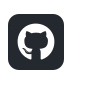
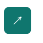
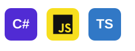
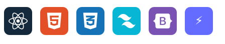
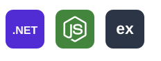

<div align="center">


<br/>

<a href="https://ramez-dev-portfolio.netlify.app/"></a>
<a href="https://www.linkedin.com/in/ramez-al-maayah-b076ba425/"></a>
<a href="https://github.com/RamezAlmaayah"></a>
<a href="mailto:ramezmayaa@gmail.com"></a>
<a href="https://ramez-dev-portfolio.netlify.app/ramez-ahmad-resume.pdf"></a>

<br/>

**📍 Amman, Jordan 🇯🇴 · Open to Junior Development Opportunities**

</div>

---


<svg xmlns="http://www.w3.org/2000/svg"
     width="720" height="326"
     viewBox="0 0 720 326">

  <style>
    .label {
      fill: #94A3B8;
      font: 15px monospace;
    }

    .value {
      fill: #2DD4BF;
      font: 15px monospace;
    }

    .heading {
      fill: #E2E8F0;
      font: bold 15px monospace;
    }

    .sub {
      fill: #64748B;
      font: 12px monospace;
    }

    .cursor {
      animation: blink 1s steps(1) infinite;
    }

    @keyframes blink {
      50% { opacity: 0; }
    }

    @media (prefers-reduced-motion: reduce) {
      .cursor { animation: none; }
    }
  </style>

  <!-- Background -->
  <rect width="720" height="326"
        rx="14" fill="#0B1220"/>

  <rect x="1" y="1" width="718" height="324"
        rx="13" fill="none"
        stroke="#263550" stroke-width="2"/>

  <!-- Terminal Header -->
  <rect x="1" y="1" width="718" height="48"
        rx="13" fill="#152238"/>

  <rect x="1" y="34" width="718" height="15"
        fill="#152238"/>

  <circle cx="24" cy="24" r="6" fill="#FF5F56"/>
  <circle cx="45" cy="24" r="6" fill="#FFBD2E"/>
  <circle cx="66" cy="24" r="6" fill="#27C93F"/>

  <text x="90" y="29" class="heading">
    ramez@github: ~/developer-profile
  </text>

  <text x="25" y="78" class="sub">
    $ whoami --details
  </text>

  <!-- Fixed Labels -->
  <text x="38" y="114" class="label">Name</text>
  <text x="38" y="149" class="label">Role</text>
  <text x="38" y="184" class="label">Background</text>
  <text x="38" y="219" class="label">Location</text>
  <text x="38" y="254" class="label">Focus</text>
  <text x="38" y="289" class="label">Interest</text>

  <!-- Colons -->
  <g fill="#64748B" font-family="monospace"
     font-size="15">
    <text x="154" y="114">:</text>
    <text x="154" y="149">:</text>
    <text x="154" y="184">:</text>
    <text x="154" y="219">:</text>
    <text x="154" y="254">:</text>
    <text x="154" y="289">:</text>
  </g>

  <!-- Typing Masks -->
  <defs>
    <clipPath id="line1">
      <rect x="177" y="96" height="22">
        <animate attributeName="width"
          values="0;345;345;0"
          keyTimes="0;0.42;0.82;1"
          dur="8s" begin="0s"
          repeatCount="indefinite"/>
      </rect>
    </clipPath>

    <clipPath id="line2">
      <rect x="177" y="131" height="22">
        <animate attributeName="width"
          values="0;345;345;0"
          keyTimes="0;0.42;0.82;1"
          dur="8s" begin="-1.3s"
          repeatCount="indefinite"/>
      </rect>
    </clipPath>

    <clipPath id="line3">
      <rect x="177" y="166" height="22">
        <animate attributeName="width"
          values="0;345;345;0"
          keyTimes="0;0.42;0.82;1"
          dur="8s" begin="-2.6s"
          repeatCount="indefinite"/>
      </rect>
    </clipPath>

    <clipPath id="line4">
      <rect x="177" y="201" height="22">
        <animate attributeName="width"
          values="0;345;345;0"
          keyTimes="0;0.42;0.82;1"
          dur="8s" begin="-3.9s"
          repeatCount="indefinite"/>
      </rect>
    </clipPath>

    <clipPath id="line5">
      <rect x="177" y="236" height="22">
        <animate attributeName="width"
          values="0;345;345;0"
          keyTimes="0;0.42;0.82;1"
          dur="8s" begin="-5.2s"
          repeatCount="indefinite"/>
      </rect>
    </clipPath>

    <clipPath id="line6">
      <rect x="177" y="271" height="22">
        <animate attributeName="width"
          values="0;345;345;0"
          keyTimes="0;0.42;0.82;1"
          dur="8s" begin="-6.5s"
          repeatCount="indefinite"/>
      </rect>
    </clipPath>
  </defs>

  <!-- Animated Values -->
  <g clip-path="url(#line1)">
    <text x="177" y="114" class="value">
      Ramez Ahmad ALMAAYE'H
    </text>
  </g>

  <g clip-path="url(#line2)">
    <text x="177" y="149" class="value">
      Full-Stack Developer
    </text>
  </g>

  <g clip-path="url(#line3)">
    <text x="177" y="184" class="value">
      B.Sc. Software Engineering
    </text>
  </g>

  <g clip-path="url(#line4)">
    <text x="177" y="219" class="value">
      Amman, Jordan
    </text>
  </g>

  <g clip-path="url(#line5)">
    <text x="177" y="254" class="value">
      React / ASP.NET Core / Node.js
    </text>
  </g>

  <g clip-path="url(#line6)">
    <text x="177" y="289" class="value">
      Architecture / AI Engineering
    </text>
  </g>

</svg>


---

## 02 / FEATURED ENGINEERING PROJECTS

<div align="center">

**Real projects. Real source code. Real demos.**

</div>

<table>
<tr>
<td width="50%" valign="top">

<h3>🧩 PLANORA</h3>
<strong>Project Management System</strong>
<p>Scrum workflows, sprint backlogs, Kanban boards, role-based access and QA review processes.</p>
<p><strong>Role:</strong> Team Leader &amp; Full-Stack Developer</p>
<p><strong>Stack:</strong> ASP.NET Core MVC, EF Core, SQL Server, Razor, JavaScript, AJAX.</p>
<div align="center">
<a href="https://planora.dynv6.net/"></a>
<a href="https://github.com/RamezAlmaayah/Planora-Project-Management-System"></a>
</div>

</td>
<td width="50%" valign="top">

<h3>📑 FR COMPARE</h3>
<strong>Supplier Quotation Management System</strong>
<p>Supplier management, RFQs, quotation comparison, split-award and weighted evaluations, and procurement decisions.</p>
<p><strong>Role:</strong> Full-Stack Developer</p>
<p><strong>Stack:</strong> React, Node.js, Express, MongoDB Atlas, JWT, GridFS.</p>
<div align="center">
<a href="https://frcompare.netlify.app/"></a>
<a href="https://github.com/RamezAlmaayah/FR-Compare"></a>
</div>

</td>
</tr>
<tr>
<td width="50%" valign="top">

<h3>🧭 UNSEEN JO</h3>
<strong>Tourism Discovery Platform</strong>
<p>Interactive maps, location-based exploration and travel-preference flows.</p>
<p><strong>Stack:</strong> React, Tailwind CSS, Supabase, PostgreSQL, React Leaflet, OpenStreetMap.</p>
<div align="center">
<a href="https://unseenjo.netlify.app/"></a>
<a href="https://github.com/RamezAlmaayah/unseen-jo"></a>
</div>

</td>
<td width="50%" valign="top">

<h3>✨ DEVELOPER PORTFOLIO</h3>
<strong>Interactive Personal Website</strong>
<p>Project case studies, responsive interfaces, accessible navigation, animations and light/dark themes.</p>
<p><strong>Stack:</strong> React, TypeScript, Vite, Tailwind CSS.</p>
<div align="center">
<a href="https://ramez-dev-portfolio.netlify.app/"></a>
<a href="https://github.com/RamezAlmaayah/ramez-portfolio"></a>
</div>

</td>
</tr>
</table>

<details>
<summary><b>🔎 More Projects &amp; Experiments</b></summary>

**Moodle Excel Management Dashboard** — Internship prototype for importing Moodle academic records using PHP, MySQL and PhpSpreadsheet.

**CaeloTerra — Climate-Smart Agriculture** — In-development decision-support concept. [View case study](https://ramez-dev-portfolio.netlify.app/projects/caeloterra).

</details>

---

## 03 / MY TECHNICAL TOOLKIT

<div align="center">

### 👨‍💻 Programming Languages


### 🎨 Frontend Development


### ⚙️ Backend Development


### 🗄️ Databases & Cloud


### 🛠️ Tools & Development


</div>

---

## 04 / EXPERIENCE & EDUCATION

<table>
<tr>
<td width="50%" valign="top">
<h3>💼 DOT Jordan</h3>
<strong>Full-Stack Development Intern</strong><br/>
<small>Jul–Sep 2026</small>
<p>Built FR Compare procurement workflows with React, Node.js, Express, MongoDB, REST APIs and JWT.</p>
</td>
<td width="50%" valign="top">
<h3>💼 The Hope International</h3>
<strong>Full-Stack Development Intern</strong><br/>
<small>Jul–Sep 2026</small>
<p>Built a Moodle Excel Management Dashboard prototype with PHP, MySQL and PhpSpreadsheet.</p>
</td>
</tr>
</table>

### 🎓 Education

**B.Sc. in Software Engineering** — Middle East University, Jordan (2022–2026)

### 📚 Continuous Learning

- **AI Engineering Training Program** — Apex Company *(In Progress)*
- **ASP.NET & Oracle APEX Training** — The Hope International
- **English for IT 1** — Cisco Networking Academy

---


<h2>05 / ENGINEERING ACTIVITY</h2>

<div align="center">

<a href="https://github.com/RamezAlmaayah?tab=overview">
  
</a>

<br/><br/>


<br/><br/>

<a href="https://github.com/RamezAlmaayah?tab=overview">
  <strong>Explore My GitHub Contributions</strong>
</a>

</div>


---

## 06 / LET'S BUILD SOMETHING

```javascript
const developer = {
  name: "Ramez Ahmad ALMAAYE'H",
  role: "Full-Stack Developer",
  location: "Amman, Jordan",
  focus: ["Software Engineering", "Web Applications"],
  mindset: "Learn. Build. Improve."
};
```

<div align="center">

**Have a project, idea or opportunity?**

<br/>

<a href="https://ramez-dev-portfolio.netlify.app/"></a>
<a href="https://www.linkedin.com/in/ramez-al-maayah-b076ba425/"></a>
<a href="https://github.com/RamezAlmaayah"></a>
<a href="mailto:ramezmayaa@gmail.com"></a>
<a href="https://ramez-dev-portfolio.netlify.app/ramez-ahmad-resume.pdf"></a>

<br/><br/>

**Think clearly. Build carefully. Ship confidently.**

<sub>Designed &amp; maintained by Ramez Ahmad ALMAAYE'H</sub>

</div>
